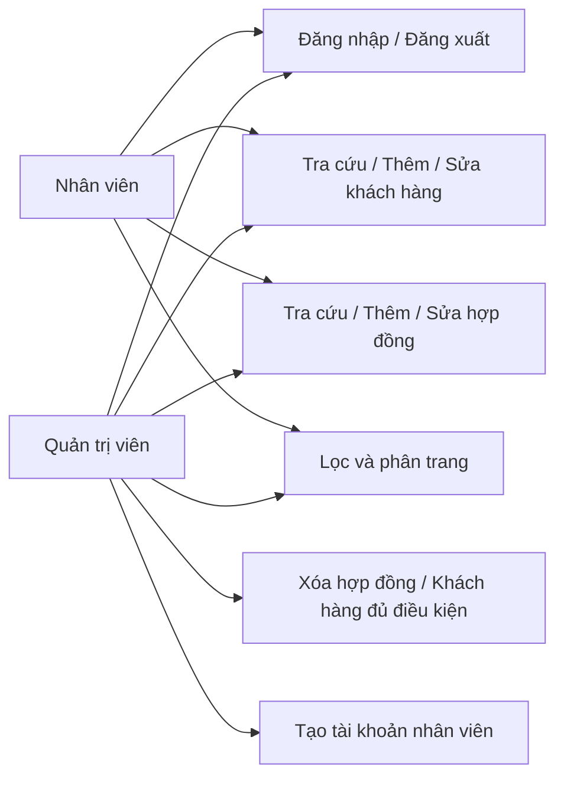
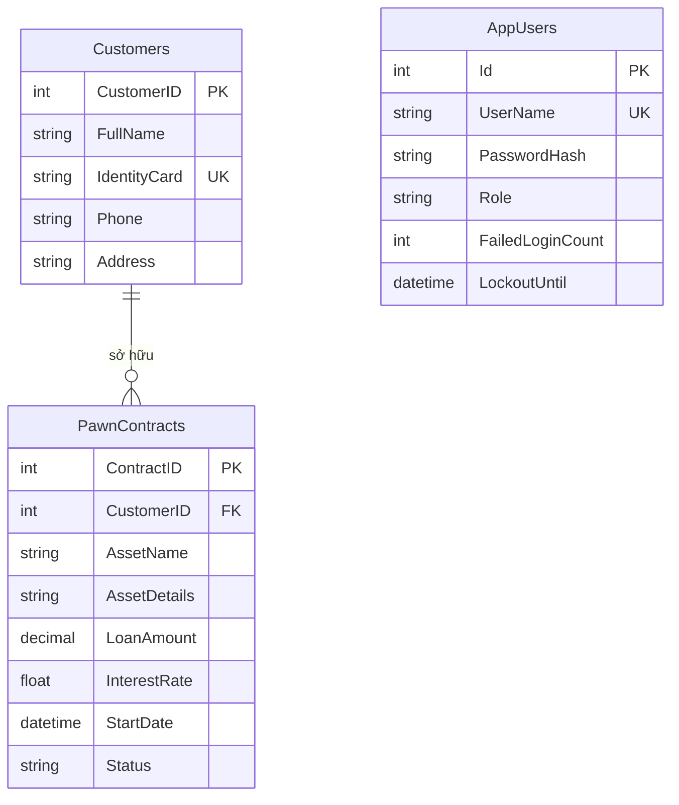

> Cập nhật bản RUN-03: hướng dẫn khởi động và cấu hình hiện hành nằm trong [README.md](README.md). Kết quả mới nhất: 67 kiểm tra ứng dụng và 10 kiểm tra launcher; SQL thật chưa xác nhận trong môi trường đóng gói.

# PawnFlow — Hướng dẫn chạy và đối chiếu web.docx

Cập nhật ngày 16/10/2026. Dự án ASP.NET Core MVC trên .NET 10, SQL Server, Entity Framework Core. Tên assembly và thư mục dự án vẫn là PawnShopManagement; PawnFlow là tên giao diện.

## 1. Thay đổi đã thực hiện

- Giao diện tiếng Việt với sidebar, màu xanh đậm, thẻ thống kê, bảng trạng thái, màn hình đăng nhập và biểu mẫu đồng bộ. Bố cục tự thích ứng; bảng rộng cuộn ngang trên điện thoại.
- CRUD hợp đồng và khách hàng; sửa nút Sửa thiếu action, kiểm tra khách hàng tồn tại, ngăn xóa khách hàng còn hợp đồng, giữ trạng thái bộ lọc và giá trị biểu mẫu khi có lỗi.
- Phân trang 10 dòng ở phía server; lọc theo tên/trạng thái. Danh sách hợp đồng dùng AJAX cho lọc và phân trang, có xử lý tải lỗi và nút Back/Forward của trình duyệt.
- Hai vai trò: Admin và Staff. Cả hai xem/thêm/sửa; chỉ Admin xóa và tạo tài khoản nhân viên. Không có mật khẩu mặc định trong ứng dụng.
- Cookie xác thực, session tìm kiếm và giới hạn đăng nhập; khóa tài khoản 5 phút sau 5 lần sai, mật khẩu băm bằng PasswordHasher của ASP.NET Core.
- Data annotations, kiểm tra phía server, chống CSRF cho MVC và REST API, tránh overposting navigation Customer, hạn chế redirect ra ngoài website.
- Sửa lỗi số thập phân của HTML number dưới vi-VN bằng model binder invariant. Mức lãi trong giao diện là giá trị do người vận hành nhập; đây không phải tư vấn pháp lý hay cơ chế xác nhận lãi suất được phép.
- REST API GET/POST/PUT/DELETE; cập nhật thư viện Pkcs lên 10.0.13, bỏ PagedList.Mvc dành cho .NET Framework và MVC.Core tham chiếu thừa.

## 2. Chạy dự án

Yêu cầu: .NET SDK 10, SQL Server hoặc SQL Server Express LocalDB, Visual Studio có workload ASP.NET nếu chạy từ IDE.

1. Mở `PawnShopManagement.csproj` hoặc solution hiện có.
2. Kiểm tra chuỗi kết nối trong `appsettings.json`. Mặc định:

```text
Server=(localdb)\mssqllocaldb;Database=PawnShopDB;Trusted_Connection=True;MultipleActiveResultSets=true
```

3. Trong SQL Server Management Studio, chạy `Database/setup.sql`. Script tạo bảng nếu chưa có, bổ sung bảng tài khoản cho dự án cũ và không xóa dữ liệu. Sao lưu cơ sở dữ liệu trước khi chạy. Nếu dữ liệu CCCD trùng, rỗng hoặc dài quá 12 ký tự, hãy rà soát và sửa dữ liệu trước khi tạo chỉ mục; không tự động cắt hoặc xóa hồ sơ.
4. Tại thư mục ứng dụng:

```powershell
dotnet restore
dotnet build
dotnet run --launch-profile https
```

5. Truy cập `https://localhost:7159/Account/Setup` trong môi trường Development, tạo quản trị viên đầu tiên rồi đăng nhập. Setup chỉ mở khi chưa có tài khoản; mật khẩu từ 10 đến 128 ký tự. Admin có mục Thêm nhân viên trên thanh điều hướng.

Lệnh `dotnet run -- --init-db` nay chạy Database/schema.sql theo transaction, tạo database nếu thiếu và bổ sung bảng/cột còn thiếu. Development cũng chạy bước này khi khởi động. Không dùng EnsureCreated cho nâng cấp schema nữa.

Nếu LocalDB báo lỗi cấu hình registry hoặc chưa có instance, kiểm tra `sqllocaldb info`, cài/khởi động SQL Server LocalDB hoặc đổi sang SQL Server đang hoạt động. Phiên sửa mã hiện tại không khởi động được LocalDB nên chưa xác nhận dữ liệu thật trên SQL Server.

## 3. Theo tiêu chí tài liệu

| Tiêu chí web.docx | Phần đáp ứng / lưu ý |
|---|---|
| ASP.NET MVC | Controllers, Views Razor, Models, EF Core |
| Các lớp người dùng | Admin / Staff, kiểm tra quyền tại controller và API |
| Template giao diện riêng | Layout PawnFlow, CSS responsive, Bootstrap và jQuery local |
| Responsive | Media queries 640/950/1200px; bảng cuộn ngang |
| Paging / Filtering | Hợp đồng và khách hàng phân trang phía server; lọc tên, trạng thái, điện thoại, CCCD |
| AJAX | Fetch danh sách hợp đồng, trả PartialView, không tải lại toàn trang |
| Thêm / sửa / xóa | Hợp đồng và khách hàng; điều kiện quyền và ràng buộc liên quan |
| Session / cookies | LastSearch và số lần đăng nhập; cookie xác thực và ngôn ngữ |
| Annotations | Required, StringLength, Range, RegularExpression, Display, DataType |
| RESTful API | `/api/contracts` và `/api/contracts/{id}` |
| Security | Authentication/Authorization, CSRF, password hash, lockout, local redirects, output encoding Razor |
| Quốc tế hóa | RequestLocalization vi-VN/en-US, cookie ngôn ngữ và tệp resource cho màn hình chính, nhãn model và thông báo. Đã có kiểm thử bản dịch. |
| Mã nguồn, hướng dẫn, script DB | Có trong gói mã nguồn và tài liệu này |
| Báo cáo mục 4 | Có bản khung phân tích/thiết kế/kiểm thử ở cuối; cần bổ sung thông tin nhóm, ảnh dữ liệu thật và kiểm thử SQL trước khi nộp |

## 4. API

Đăng nhập bằng cookie như MVC. Khi chưa đăng nhập: API trả 401; không đủ quyền: 403. GET danh sách trả `total`, `page`, `pageSize`, `items` với tối đa 10 phần tử.

| HTTP | Đường dẫn | Ý nghĩa |
|---|---|---|
| GET | `/api/contracts?search=Honda&status=DangCam&page=1` | Danh sách, lọc và phân trang |
| GET | `/api/contracts/1` | Chi tiết; 404 nếu không tồn tại |
| POST | `/api/contracts` | Tạo mới, 201 và Location |
| PUT | `/api/contracts/1` | Cập nhật toàn bộ dữ liệu, 204 |
| DELETE | `/api/contracts/1` | Chỉ Admin, 204 |

POST/PUT/DELETE yêu cầu anti-forgery token vì dùng cookie xác thực. Sau khi đăng nhập, GET `/Account/Token`, lấy `requestToken`, giữ cookie đi kèm và gửi header `RequestVerificationToken`. Không tắt chống CSRF để gọi API.

```json
{
  "customerID": 1,
  "assetName": "Tài sản ví dụ",
  "assetDetails": "Mô tả nhận dạng",
  "loanAmount": 2500000,
  "interestRate": 1.5,
  "startDate": "2026-10-16",
  "status": "DangCam"
}
```

PUT cần thêm `contractID` trùng id trong URL. Ngày cầm từ 01/01/2000 đến ngày hiện tại; trạng thái thuộc DangCam/DaChuoc/DaThanhLy. Tiền vay 500.000–1.000.000.000 đồng; validation lãi suất 0–100 là ràng buộc dữ liệu, không phải giới hạn pháp lý được xác nhận.

## 5. Kết quả kiểm tra thực tế

- `dotnet build --no-restore`: thành công, 0 lỗi / 0 cảnh báo sau restore thư viện mới.
- `dotnet list package --vulnerable --include-transitive --no-restore`: không phát hiện package có lỗ hổng từ nguồn NuGet được truy vấn ngày 16/10/2026. Đây không thay thế kiểm toán bảo mật ứng dụng.
- 32 kiểm tra tích hợp dùng WebApplicationFactory, cookie/antiforgery thật và EF Core InMemory đã PASS. Chi tiết ở `integration-results.txt`; mã kiểm tra trong thư mục `Verification` của gói tải về.
- Kiểm tra giao diện đăng nhập bằng trình duyệt ở viewport điện thoại và 1440px. Danh sách hợp đồng, lọc AJAX ra đúng 2 hợp đồng đã chuộc, và biểu mẫu sửa giữ đúng lãi 1.5/trạng thái cũng đã được kiểm tra trên test host với dữ liệu giả.
- Chưa xác minh SQL Server LocalDB, transaction khởi tạo admin, CHECK/UNIQUE/FK trên SQL Server, triển khai HTTPS thực tế và tải đồng thời. Không tính những mục này là PASS.

Chạy lại bộ kiểm tra (từ thư mục gói giải nén):

```powershell
$env:PAWN_PROJECT_ROOT = (Resolve-Path .\PawnShopManagement).Path
$env:PAWN_CHECK_OUTPUT = (New-Item -ItemType Directory -Force .\test-results).FullName
dotnet run --project .\Verification\Checks.csproj
```

Bộ kiểm tra tạo dữ liệu giả trong bộ nhớ, không ghi vào SQL Server. Tài khoản kiểm thử chỉ tồn tại trong test host; không phải tài khoản để đăng nhập ứng dụng chính.

## 6. Gợi ý báo cáo theo mục 4

### 4.1. Tổng quan và phân tích

Hệ thống hỗ trợ cửa hàng lưu hồ sơ khách hàng, tài sản cầm cố, khoản vay và quá trình chuyển trạng thái hợp đồng. Admin chịu trách nhiệm quản trị tài khoản và xóa dữ liệu. Staff xử lý giao dịch thường ngày, xem/tạo/sửa hồ sơ; không có quyền xóa.

Nghiệp vụ: tạo khách hàng → tạo hợp đồng DangCam → cập nhật thông tin, theo dõi danh sách → chuyển DaChuoc hoặc DaThanhLy theo thực tế. Phiên bản này chưa có sổ quỹ, lịch sử thu lãi, lịch sử thay đổi trạng thái hoặc đối soát thanh toán; không diễn giải trạng thái DaChuoc thành bằng chứng thu đủ tiền.

### 4.2. Thiết kế

Use case:



ERD:



Sitemap: Account (Login/Setup/Logout/CreateStaff/Denied), Contracts (Index/Create/Edit/Delete), Customers (Index/Create/Edit/Delete), Home/Privacy, api/contracts.

Wireframe: sidebar trái; topbar có breadcrumb/ngôn ngữ/tài khoản; nội dung có tiêu đề và nút tạo → ba thẻ thống kê → bộ lọc → bảng dữ liệu → phân trang. Trên điện thoại sidebar chuyển thành thanh ngang, thẻ thống kê xếp dọc. Form chia vùng thông tin và thẻ giải thích; thu về một cột trên màn nhỏ.

### 4.3. Triển khai

Mô hình MVC: Razor hiển thị; controller xác thực quyền, kiểm tra dữ liệu và điều phối EF; DbContext ánh xạ SQL Server. Fetch tải PartialView cho danh sách; Bootstrap hỗ trợ bảng/form và jQuery phục vụ validation. Bổ sung ảnh danh sách, tạo/sửa, khách hàng, lỗi validation, từ chối quyền và API sau khi chạy cơ sở dữ liệu thật. Không trình bày ảnh dữ liệu kiểm thử giả như dữ liệu vận hành thật.

### 4.4. Kiểm thử

| Mục tiêu | Dữ liệu / thao tác | Kỳ vọng | Thực tế |
|---|---|---|---|
| Chặn truy cập chưa đăng nhập | GET Contracts và API không cookie | MVC redirect, API 401 | PASS InMemory |
| Chống CSRF | POST không token | 400 | PASS |
| Phân quyền | Staff tạo tài khoản / xóa API | Bị từ chối | PASS |
| Phân trang | 12 hợp đồng giả, page 2 | 2 phần tử | PASS |
| Lọc | 10 DangCam, 2 DaChuoc | Lọc DangCam ra 10 | PASS |
| AJAX | Header X-Requested-With | PartialView, không layout | PASS |
| Thêm khách hàng | CCCD hợp lệ và trùng | Lần đầu lưu, trùng bị chặn | PASS |
| Nhập số | 2500000 và 1.5 dưới vi-VN | Giá trị giữ nguyên | PASS |
| Validation | Tiền 1, lãi -1, khách 999, ngày tương lai | Không lưu | PASS |
| REST | POST/PUT/DELETE/GET sau xóa | 201/204/204/404 | PASS |
| Ràng buộc khách hàng | Xóa khách còn hợp đồng | Giữ nguyên khách | PASS trong ứng dụng |
| SQL Server | Chạy setup.sql, thử FK/UNIQUE/CHECK | Ràng buộc đúng | Chưa chạy |

Lỗi đã sửa: action Edit thiếu; navigation Customer làm model validation thất bại; dữ liệu số theo culture không khớp HTML number; phân trang/phân quyền/CRUD khách hàng chưa có; package MVC cũ không phù hợp .NET 10 và thư viện Pkcs có cảnh báo bảo mật ở bản cũ.

### 4.5. Kết luận và phát triển

Đã bổ sung chức năng quản lý nền tảng và giao diện đồng bộ theo các nhóm tiêu chí. Cần kiểm thử cơ sở dữ liệu thật trước khi nghiệm thu. Hướng phát triển: nhật ký kiểm toán, lịch sử thanh toán/lãi, báo cáo doanh thu, khôi phục dữ liệu đã xóa, quản lý vòng đời tài khoản và dịch giao diện đầy đủ bằng resource files.

## 7. Vận hành

- `App_Data/keys` lưu khóa bảo vệ cookie, nằm ngoài wwwroot và được .gitignore bỏ qua. Windows dùng DPAPI theo tài khoản chạy ứng dụng; không commit hoặc gửi khóa. Khi chạy nhiều máy/đổi tài khoản dịch vụ, cần cấu hình kho khóa và bảo vệ khóa phù hợp. Linux cần cấu hình thêm cơ chế mã hóa khóa khi lưu.
- Setup chỉ dùng tại máy tin cậy trong Development, trước khi mở truy cập từ mạng. Production cần HTTPS hợp lệ, tài khoản SQL tối thiểu quyền, sao lưu DB và không bật Developer Exception Page.
- Cấu hình secret bằng biến môi trường `ConnectionStrings__DefaultConnection` hoặc user secrets. Không đưa mật khẩu SQL vào mã nguồn.
- Tính năng khóa đăng nhập cơ bản chưa thay thế hệ thống chống brute-force phân tán, MFA hay dịch vụ Identity đầy đủ. Cần kiểm thử tranh chấp dữ liệu khi nhiều nhân viên cùng sửa/xóa hồ sơ.


## Cập nhật hoàn thiện

Xem MO-VA-CHAY.md cho hướng dẫn mới nhất. Tai-lieu chứa báo cáo PDF, sơ đồ draw.io, test case CSV và PowerPoint. SQL Server chưa xác minh trong phiên công cụ; cần chạy Kiem-tra-SQL.cmd trước nghiệm thu.
